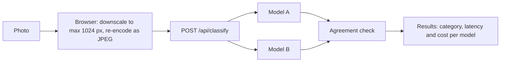

# waste-sorter

A portfolio demo that shows AI as one step inside a product, not as a chat: you upload a photo of an item, and two models sort it into a Helsinki region (HSY) waste category.

## 🔍 How it works

> **Models are currently mocked.** The classifier returns a deterministic fake category, latency and token usage. No external API is called yet.



1. The browser downscales the image and re-encodes it as JPEG.
2. The server validates size (max 2 MB) and type, then sends the same image to both models in parallel.
3. Each model returns one category id from a fixed list (`config/categories.ts`). Anything else counts as "unrecognized".
4. If both models return the same category, they agree. If not, both answers are shown.
5. Cost per call is token usage × the price table in `config/pricing.ts`. The UI shows the cost per image, the session total, and what 1,000 images would cost.

## 🔒 Privacy

- Images are never stored or logged. They are held in memory only for the duration of the request.
- EXIF metadata (such as location) is stripped in the browser, because the canvas re-encode does not keep it.
- Planned: rate limiting will use a hashed IP, never the raw IP.

## 🧰 Tech stack

| Area     | Tools                                    |
| -------- | ---------------------------------------- |
| Backend  | AdonisJS 7, TypeScript, SQLite           |
| Frontend | Inertia, React 19, Vite                  |
| Tests    | Vitest (logic), Playwright (upload flow) |
| Runtime  | Docker, single container, `GET /health`  |

## 📋 Status

- [x] 1. Skeleton with a mock classifier
- [x] 2. Docker image + CI workflow that pushes to GHCR
- [ ] 3. Usage caps: per IP and global monthly
- [ ] 4. Real model calls
- [ ] 5. Eval script, UI polish, "show what happened" view

On every push to `main`, CI runs the tests, then builds a linux/amd64 image and pushes it to `ghcr.io/anttijerta/waste-sorter`, tagged with the commit SHA and `latest`.

## 💻 Run locally

Requires Node.js 24.

```sh
npm install
cp .env.example .env
node ace generate:key

npm run dev        # http://localhost:3333
```

Tests:

```sh
npm run test:unit                    # Vitest
npx playwright install chromium      # first time only
npm run test:e2e                     # Playwright, starts its own server on port 3334
npm test                             # both
```

Docker:

```sh
docker build -t waste-sorter .
docker run --rm -p 3333:3333 -e APP_KEY=<random 32+ char string> waste-sorter
curl http://localhost:3333/health
```
