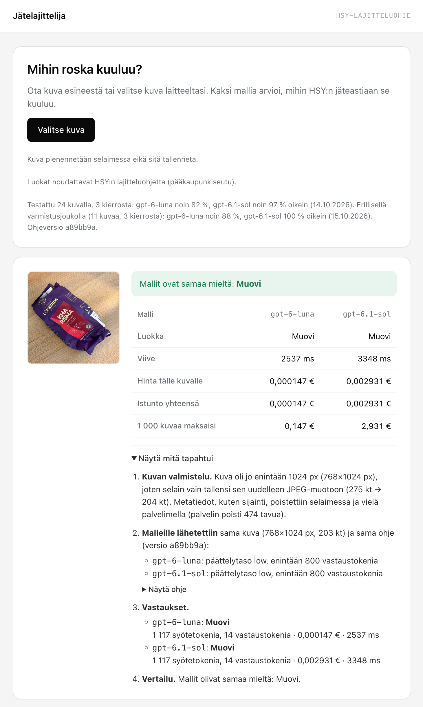
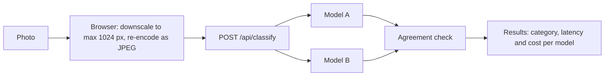

# waste-sorter

**Blog post (in Finnish):** https://www.jerta.fi/blog/jatelajittelija/

The live demo is no longer online. You can run it locally with Docker without an API key, see Run locally below.



A portfolio demo that shows AI as one step inside a product, not as a chat: you upload a photo of an item, and two models sort it into a Helsinki region (HSY) waste category.

Two models run side by side to make the cost/accuracy trade-off visible: on the test set below, `gpt-6.1-sol` costs about 20× as much per image as `gpt-6-luna` and is right 97 % of the time versus 82 %.

## 🔍 How it works

Model A is `gpt-6-luna` and model B is `gpt-6.1-sol`, both called through the OpenAI Responses API with the same prompt, image and reasoning effort. Without an API key the app runs in **demo mode**: both models are simulated, and the UI says so. In production this needs `ALLOW_MOCK_MODELS=true`; otherwise a missing key stops the app at startup, so a deployment never shows simulated results by accident.



1. The browser downscales the image and re-encodes it as JPEG.
2. The server validates size (max 2 MB and 1024 px) and type, removes any metadata left in the JPEG, then sends the same image to both models in parallel.
3. Each model must answer with structured output whose only field is one category id from a fixed list (`config/categories.ts`). Anything else counts as "unrecognized".
4. If both models return the same category, they agree. If not, both answers are shown.
5. Cost per call is token usage from the API response, reasoning tokens included, × the price table in `config/pricing.ts`. The UI shows each model's cost per image, session total, and what 1,000 images would cost.

## 🔒 Privacy

- Images are never stored or logged by this app. They are held in memory only for the duration of the request.
- To classify an image, the app sends it to the OpenAI API with response storage turned off (`store: false`). OpenAI's API data policies apply to that request.
- Metadata such as location is removed twice: in the browser, because the canvas re-encode does not keep it, and again on the server before the image is sent to the models. The server does not rely on the browser: it drops all EXIF, XMP, ICC and comment segments and anything after the end of the image, without re-encoding.
- Daily statistics (`node ace stats`) hold only counters per UTC day: images, agreements, errors, rejected requests per limit, total cost and answers per category and model. No visitor data; they are kept permanently.
- Rate limiting never stores the raw IP: the key is an HMAC-SHA256 of the IP with the app secret and the UTC date, so it cannot be linked across days. Usage rows are deleted after 35 days.

## 🚦 Usage limits

Each IP may classify 5 images per minute and 20 per UTC day, and all users together may spend an estimated 5 € per UTC month (see Configuration below). Budget is reserved before the models are called, so parallel requests cannot exceed the cap. Failed calls still count. When a limit is hit, the API returns 429 and the UI says whether it is the user's limit or the demo is paused for the month.

**Behind a reverse proxy**, set `TRUSTED_PROXIES` to the proxy's IP or subnet. Only that source may set `X-Forwarded-For`; by default nobody is trusted. The Compose network must use a fixed subnet (`ipam.config.subnet`), because Docker assigns subnets dynamically and they can change when containers are recreated. Do not publish the app port directly.

## ⚙️ Configuration

All settings are environment variables; `.env.example` lists them with local defaults.

| Variable                       | Default                     | Purpose                                                                                               |
| ------------------------------ | --------------------------- | ----------------------------------------------------------------------------------------------------- |
| `APP_KEY`                      | (required)                  | App secret, also the key for hashing IPs. Generate with `node ace generate:key`.                      |
| `MODEL_API_KEY`                | empty                       | OpenAI API key. Empty means demo mode; in production only with `ALLOW_MOCK_MODELS=true`.              |
| `ALLOW_MOCK_MODELS`            | `false`                     | `true` allows demo mode in production. Without it, production refuses to start without a key.         |
| `MODEL_A`, `MODEL_B`           | `gpt-6-luna`, `gpt-6.1-sol` | Model ids. Each needs a price in `config/pricing.ts` and its reasoning efforts in `config/models.ts`. |
| `MODEL_REASONING_EFFORT`       | `low`                       | Same for both models. The app refuses to start if a model does not support it.                        |
| `MODEL_TIMEOUT_MS`             | `20000`                     | Timeout per model call. Calls are never retried automatically.                                        |
| `RATE_LIMIT_PER_IP_PER_MINUTE` | `5`                         | Images per IP per minute.                                                                             |
| `RATE_LIMIT_PER_IP_DAILY`      | `20`                        | Images per IP per UTC day.                                                                            |
| `GLOBAL_MONTHLY_CAP_EUR`       | `5`                         | Estimated spend of all users per UTC month.                                                           |
| `TRUSTED_PROXIES`              | empty                       | Reverse proxy IPs/CIDRs allowed to set `X-Forwarded-For`.                                             |
| `DB_PATH`                      | `/app/data/db.sqlite3`      | SQLite file for usage counters. Never inside `tmp/`.                                                  |

**Using your own API key**

1. Create an API key in the OpenAI platform dashboard, ideally in a separate project used only for this demo.
2. Put it in `.env` as `MODEL_API_KEY=…` locally, or in your deployment's secrets. Never commit it.
3. **Set a monthly budget or spend limit for that project at OpenAI.** `GLOBAL_MONTHLY_CAP_EUR` is an estimate kept by this app; the provider-side limit is the hard stop if something goes wrong.

## 📊 Evaluation

Baseline on 24 labelled photos (plus one out-of-scope item, not scored), 3 runs, reasoning effort `low`, run with `node ace eval --yes --runs=3`. The labelled photos are not published with this repo.

|                           | `gpt-6-luna`      | `gpt-6.1-sol`   |
| ------------------------- | ----------------- | --------------- |
| Accuracy, mean (min–max)  | 82 % (79–83 %)    | 97 % (92–100 %) |
| Cost per 1,000 new images | about 0.13–0.17 € | about 2.5–3 €   |
| Median latency            | 1.7 s             | 2.4 s           |

Costs are for photos the models have not seen before; the upper end includes OpenAI's cache-write surcharge on new input. Repeating the same photos is far cheaper (about 0.04 € and 0.37 € per 1,000) because OpenAI serves most of the input from its prompt cache.

Costs are the token counts reported by the API × the price table in `config/pricing.ts` (prices checked on 2026-10-14), with USD prices counted 1:1 as EUR. For `gpt-6.1-sol`, 2.5–3 € is the measured range; the upper end is a run billed with cache writes. For `gpt-6-luna`, the measured range is 0.13–0.14 €; the upper end of 0.17 € is computed, not measured, by billing all input as cache writes (1.25× the input rate).

Adding six HSY sorting rules to the prompt raised accuracy on this set (Luna 93 %, Sol 100 %) but lowered it on a separate 12-photo holdout set (11 scored + 1 out of scope; Luna 88 → 85 %, Sol 100 → 94 %), so the baseline prompt was kept.

## 🧰 Tech stack

| Area     | Tools                                       |
| -------- | ------------------------------------------- |
| Backend  | AdonisJS 7, TypeScript, SQLite              |
| Frontend | Inertia, React 19, Vite                     |
| Tests    | Vitest (logic), Playwright (upload flow)    |
| Models   | OpenAI Responses API, official `openai` SDK |
| Runtime  | Docker, single container, `GET /health`     |

## 🚀 Deployment

On every push to `main`, CI runs the tests, then builds a linux/amd64 image and pushes it to `ghcr.io/anttijerta/waste-sorter`, tagged with the commit SHA and `latest`.

The demo was deployed with Docker Compose behind Caddy; the setup is documented in https://github.com/anttijerta/infra.

## 💻 Run locally

Requires Node.js 24.

```sh
npm install
cp .env.example .env
node ace generate:key
node ace migration:run   # creates data/db.sqlite3

npm run dev        # http://localhost:3333
```

Tests:

```sh
npm run test:unit                    # Vitest
npx playwright install chromium      # first time only
npm run test:e2e                     # Playwright, starts its own servers on ports 3334, 3336, 3337
npm test                             # both
```

Daily statistics:

```sh
node ace stats             # last 30 days
node ace stats --days=90
```

Eval (makes paid API calls):

```sh
node ace eval                # dry run: prints the number of calls and the worst-case cost
node ace eval --yes          # runs both models in parallel per image, like the app
node ace eval --yes --sequential   # one model after the other, to compare latency
node ace eval --yes --runs=3       # repeat the set, report consistency and accuracy ranges
node ace eval --yes --runs=3 --labels=labels-holdout.csv   # the holdout set in the data folder
node ace eval --yes --cache-mode=explicit  # compare with prompt caching off (the app uses OpenAI's default caching)
```

`EVAL_DATA_DIR` (or `--data-dir`) points to a folder outside this repo with `labels.csv` (`file,expected,difficulty,note`; difficulty is `easy`, `hard` or `oos`) and the photos in `images-jpg/`. Each photo is prepared like the browser does it (upright, max 1024 px, JPEG, metadata such as GPS removed) and classified with the app's own classifier code and settings, at most 20 calls per minute per model. Results go to `EVAL_DATA_DIR/results/` as JSON and Markdown. The result line on the page comes from `config/eval_summary.ts`; update it after an eval run (a test fails if the prompt changed since). Without an API key it runs the simulated models and marks the results `mock`.

Docker:

```sh
docker build -t waste-sorter .
docker run --rm -p 3333:3333 -v waste-sorter-data:/app/data \
  -e APP_KEY=<random 32+ char string> \
  -e ALLOW_MOCK_MODELS=true \
  waste-sorter
# Demo mode with simulated models. For the real models, pass -e MODEL_API_KEY=… instead.
curl http://localhost:3333/health
```
